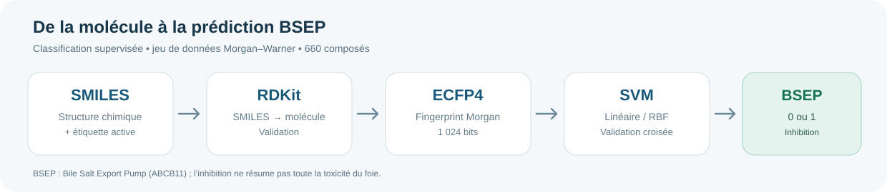
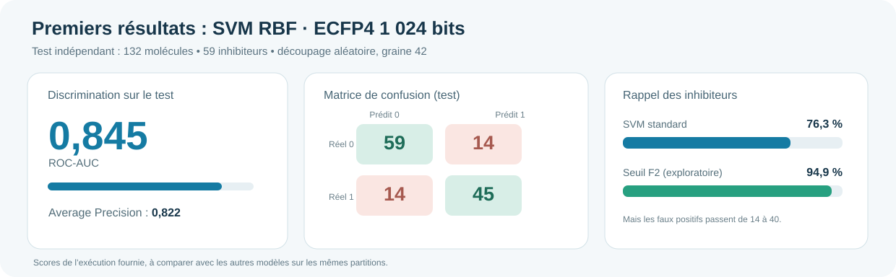

# MLB – Toxicity of Drugs | Prédiction de l’inhibition de BSEP

## Objectif

L’objectif est de prédire si une molécule inhibe la protéine BSEP (Bile Salt Export Pump, ABCB11) à partir de sa structure chimique. BSEP permet l’export des sels biliaires par les hépatocytes ; son inhibition constitue un mécanisme associé à certaines atteintes hépatiques médicamenteuses. Une inhibition de BSEP **n’équivaut pas** à une prédiction de la toxicité hépatique globale.

Le jeu de données public Morgan–Warner contient **660 molécules**. Les structures sont représentées par des SMILES et l’étiquette `active` vaut 1 pour les inhibiteurs, 0 pour les non-inhibiteurs.



## Partie SVM

Les SMILES sont convertis avec RDKit en fingerprints **Morgan ECFP4 (rayon 2, 1 024 bits)**. Deux Support Vector Machines sont comparés : **SVM linéaire** et **SVM à noyau RBF**. Les hyperparamètres sont choisis par validation croisée stratifiée sur l’entraînement, puis le meilleur modèle est évalué sur un test indépendant.

**Résultats obtenus sur la première séparation aléatoire (graine 42)** :



| Indicateur | Résultat |
|---|---:|
| Jeu d’entraînement / test | 528 / 132 molécules |
| SVM retenu | RBF, C = 10, gamma = scale |
| ROC-AUC (test) | 0,845 |
| Average Precision (test) | 0,822 |
| Accuracy (test) | 78,8 % |
| Rappel des inhibiteurs (test) | 76,3 % |
| F1-score (test) | 0,763 |
| Faux négatifs / faux positifs | 14 / 14 |

Ces chiffres correspondent à **une exécution**, pas à une performance garantie sur de nouvelles molécules. La séparation aléatoire peut être optimiste lorsque des molécules chimiquement proches apparaissent des deux côtés.

## Organisation du dépôt

```text
MLB_Toxicity/
├── README.md
├── requirements.txt
├── .gitignore
├── data/
│   ├── README.md
│   └── morgan_warner_combined_bsep_data.csv
├── notebooks/
│   └── 01_SVM_BSEP.ipynb
├── src/
│   └── svm_bsep.py
├── results/
│   ├── README.md
│   ├── svm_benchmark_cv.csv
│   ├── svm_benchmark_test.csv
│   └── svm_test_seuil_f2.csv
└── assets/
    ├── pipeline.svg
    └── resultats.svg
```

## Utilisation

**Dans Google Colab :** ouvrir `notebooks/01_SVM_BSEP.ipynb`, puis exécuter les cellules dans l’ordre. Le notebook explique chaque étape en français et affiche les visualisations. Le CSV est récupéré depuis son URL publique si aucun fichier local n’est présent.

**En local :** après avoir cloné le dépôt, depuis sa racine :

```bash
python -m pip install -r requirements.txt
python src/svm_bsep.py
```

Les images et les fichiers de scores créés à l’exécution sont enregistrés dans les dossiers `figures/` et `outputs/` (ignorés par Git).

## Pour comparer les modèles du groupe

La comparaison entre SVM, Random Forest et les autres classificateurs exige **les mêmes molécules dans le test**. Le script exporte `outputs/splits_bsep.csv`, contenant les SMILES canoniques et la partition train/test. La graine aléatoire utilisée ici est 42. Les colonnes des CSV de résultats sont décrites dans `results/README.md`.

## Métriques et interprétation

- **ROC-AUC** : capacité à classer les inhibiteurs avant les non-inhibiteurs, indépendamment du seuil de décision.
- **Average Precision (AP)** : résumé de la courbe précision–rappel.
- **Rappel** : fraction d’inhibiteurs réellement détectés.
- **Précision** : fraction de véritables inhibiteurs parmi les alertes.
- **F1** : compromis entre précision et rappel.
- **Faux négatif** : inhibiteur non détecté ; **faux positif** : non-inhibiteur signalé à tort.

Un seuil exploratoire sélectionné sur l’entraînement en maximisant F2 a augmenté le rappel sur le test de 76,3 % à 94,9 %, au prix de 14 à 40 faux positifs. Il ne faut pas sélectionner ce seuil en regardant le test.

## Sources

- McLoughlin et al. (2021), *Machine Learning Models to Predict Inhibition of the Bile Salt Export Pump*, [DOI](https://doi.org/10.1021/acs.jcim.0c00950).
- [Jeu public Morgan–Warner, ATOMScience / AMPL](https://github.com/ATOMScience-org/AMPL/tree/master/atomsci/ddm/examples/BSEP/data).
- [Documentation RDKit](https://www.rdkit.org/docs/) ; [documentation scikit-learn SVC](https://scikit-learn.org/stable/modules/generated/sklearn.svm.SVC.html).

## Limites

Ce modèle ne remplace pas les mesures biologiques. Le jeu public réunit deux sources expérimentales aux seuils de classification différents. Un test de généralisation par **scaffold split** serait une extension pertinente.


## Réseau de neurones MLP — complément du SVM

Un **MLP (perceptron multicouche)** a été ajouté pour tester une approche non linéaire avec les mêmes fingerprints ECFP4 de 1 024 bits. Le modèle est entraîné avec `MLPClassifier` de scikit-learn, `early_stopping` et validation croisée à cinq plis.

- [Notebook MLP avec les étapes et graphiques](notebooks/02_MLP_BSEP.ipynb)
- [Script Python MLP](src/mlp_bsep.py)
- [Résultats MLP en validation croisée](results/mlp_benchmark_cv.csv)
- [Résultats MLP sur le test](results/mlp_benchmark_test.csv)

### Première comparaison SVM / MLP

| Mesure (132 molécules de test) | SVM RBF | MLP |
|---|---:|---:|
| ROC-AUC | **0,845** | 0,783 |
| Average Precision | **0,822** | 0,775 |
| Rappel des inhibiteurs | **76,3 %** | 62,7 % |
| F1-score | **0,763** | 0,661 |
| Faux négatifs | **14** | 22 |

**Interprétation :** sur cette partition aléatoire, le SVM obtient de meilleurs scores que le MLP testé. Ce résultat ne signifie pas que tous les réseaux de neurones sont inférieurs aux SVM. Le dataset est petit (660 molécules), la comparaison doit rester liée à cette séparation et à ces hyperparamètres.

Pour reproduire les expériences, garder **exactement les mêmes molécules dans le test**. Les modèles ne permettent pas d'affirmer qu'un médicament est globalement toxique ou sûr.

